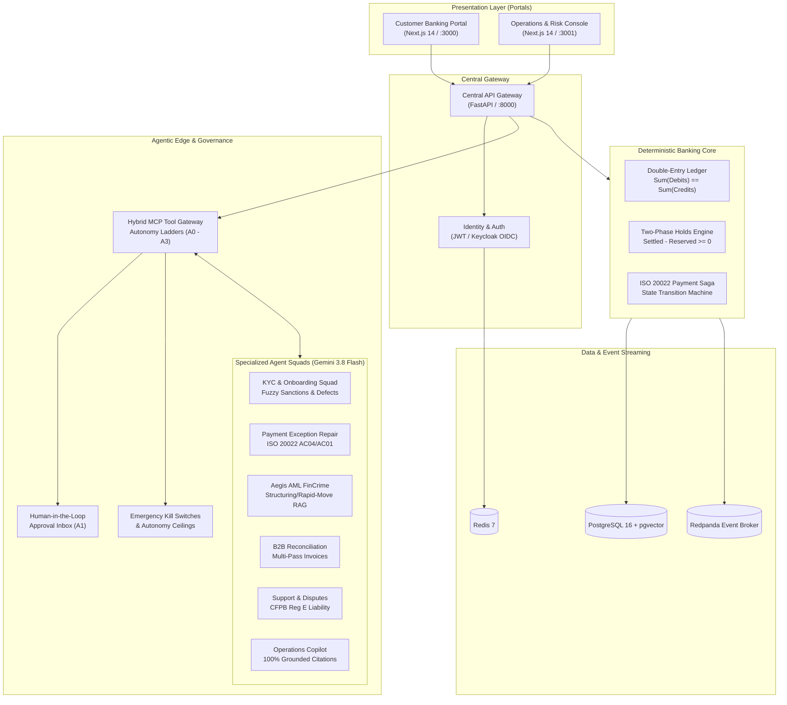

# 🛡️ Aegis / Meridian: Agentic Payments and Banking Platform

[](https://www.python.org/)
[](https://fastapi.tiangolo.com/)
[-black?logo=next.js)](https://nextjs.org/)
[](https://deepmind.google/technologies/gemini/)
[](https://modelcontextprotocol.io/)
[](https://redpanda.com/)
[](https://www.postgresql.org/)
[](LICENSE)

> An enterprise-grade agentic payments and simulated banking platform powered by **Google Gemini 3.8 Flash**, **deterministic double-entry bookkeeping**, and a **Model Context Protocol (MCP) Tool Gateway** with bounded autonomy ladders (A0–A3) and human-in-the-loop governance.

---

## 🏛️ System Architecture

Aegis decouples high-assurance financial primitives from non-deterministic generative models: **money movement and accounting rules are NEVER delegated to LLMs**. AI agents operate strictly on the *edge* through typed MCP tools requiring cryptographic and administrative authorization.



---

## 🌟 Key Technical Highlights (For Technical Interviewers)

1. **Deterministic Double-Entry Ledger Core**:
   - Zero-sum balancing guarantees: Every money movement creates $\ge 2$ balanced legs (`Sum(Debits) == Sum(Credits)`).
   - Real-time balance invariants: `Available Balance = Settled - Reserved Holds >= 0.00`.
   - Accounting rules are enforced via database constraints and deterministic Python engines—never delegated to an LLM.

2. **Bounded Autonomy Ladders (ADR-002)**:
   - **A0 (Suggest)**: Agent drafts suggestions; human executes.
   - **A1 (Act with Approval)**: Agent proposes write action; held in `approval_inbox` until authorized by an operator or compliance officer.
   - **A2 (Act within Limits)**: Autonomous execution within strict financial and policy ceilings (e.g., transfers $< \$1,000$).
   - **A3 (Fully Autonomous)**: Autonomous execution (explicitly blocked for money movement).

3. **Adversarial Verifier & Anti-Hallucination Architecture**:
   - Suspicious Activity Report (SAR) narratives generated by the AML squad require **100% citation coverage**.
   - Every monetary figure or factual assertion must reference a verified token in the cryptographic evidence store (`[EVID-...]`). Unsupported claims trigger instant rejection by the adversarial verifier.

4. **Adversarial Prompt Injection Defenses**:
   - In-flight scanner inspects payment memos and narratives for instruction override attacks (`"ignore previous instructions"`, `"do not file SAR"`), neutralizing jailbreaks before LLM ingestion (0.0% Attack Success Rate in CI gates).

5. **Multi-Pass Reconciliation Engine**:
   - Pass 1: Deterministic 1-to-1 exact matching.
   - Pass 2: Levenshtein distance fuzzy invoice reference matching.
   - Pass 3: 2-to-1 split payment matching (single ledger posting settling multiple outstanding invoices).
   - Pass 4: Partial payment tracking with balance remainder ledger records.

6. **Statutory Regulation E Compliance Classifier**:
   - Implements CFPB 12 CFR § 1005 compliance rules: 60-day notice verification (§ 1005.11(b)), 10-business-day investigation deadline with mandatory provisional credit (§ 1005.11(c)), and tiered consumer liability calculation ($50 / $500 tiers under § 1005.6).

7. **Production Infrastructure & Observability**:
   - Multi-stage Dockerfiles, Helm v2 charts with isolated Kubernetes namespaces, least-privilege network policies, Terraform modules, Argo CD canary rollouts, and Prometheus metrics scraping.

---

## Directory Structure

```text
Aegis/
├── apps/                        # Front-end portals (Next.js monorepo)
│   ├── customer-portal/         # B2C & B2B customer web portal
│   ├── ops-console/             # Back-office operations & agent supervision console
│   └── api-gateway/             # Gateway and BFF configuration
├── services/                    # Banking core services (modular monolith)
│   ├── accounts_ledger/         # Double-entry ledger, accounts, balances, holds
│   ├── identity/                # Dual JWT / Keycloak OIDC authentication
│   ├── onboarding/              # Customer applications & KYC intake
│   ├── payments/                # Payment instructions & lifecycle saga
│   ├── b2b/                     # Invoices, maker-checker, bulk payments
│   ├── risk_compliance/        # Rules engine, alerts, screening
│   └── notifications/           # Push, email, SMS notification dispatch
├── agent_platform/              # Agent framework & governance
│   ├── gateway/                 # MCP Tool Gateway, permissions, autonomy checks
│   ├── squads/                  # Onboarding, Payment Repair, Aegis (FinCrime)
│   ├── prompts/                 # Versioned prompt templates
│   ├── schemas/                 # Pydantic agent input/output contracts
│   ├── guardrails/              # Injection defenses & PII redaction
│   └── rag/                     # AML policy RAG with pgvector
├── simulators/                  # Outside world network simulators
│   ├── payment_network/         # ISO 20022 clearing simulator
│   ├── kyc_provider/            # ID verification simulator
│   ├── sanctions_feed/          # OFAC / PEP watchlist feed
│   └── traffic_generator/       # Background transaction activity
├── data/                        # Datasets & synthetic generation
│   ├── generator/               # Deterministic synthetic data generator
│   ├── corpora/                 # Policy documents & generated datasets
│   └── documents/               # Sample ID cards and utility bills
├── evals/                       # Evaluation & CI benchmark gates
│   ├── golden/                  # Labeled ground-truth test cases
│   ├── suites/                  # Squad trajectory and security evals
│   └── judges/                  # LLM-as-a-judge scoring
├── infra/                       # Infrastructure configuration
│   ├── docker/                  # Docker Compose (Postgres+pgvector, Redis, Redpanda)
│   ├── helm/                    # Kubernetes charts
│   └── terraform/               # Cloud infrastructure
├── docs/                        # Project documentation & ADRs
│   ├── adr/                     # Architecture Decision Records
│   ├── autonomy-matrix.md       # Bounded autonomy levels (A0-A3)
│   └── threat-model.md          # Security & injection threat analysis
└── tests/                       # Automated unit, integration, and property tests
```

---

## Quick Start & Running the Platform

For full details, port mappings, and cURL commands, see the **[Run & Operations Guide](file:///home/zabedin/projects/Aegis/docs/running-the-platform.md)**.

### 1. Prerequisites
- **Python 3.12+** & **uv** (`curl -LsSf https://astral.sh/uv/install.sh | sh`)
- **Node.js 18+** / **20+ LTS** & **npm**
- **Docker & Docker Compose**
- **Google Gemini API Key** (`GEMINI_API_KEY`)

### 2. Configure Environment
```bash
cp .env.example .env
# Set GEMINI_API_KEY in .env
```

### 3. Start Local Infrastructure
Start PostgreSQL with `pgvector`, Redis 7, and Redpanda (Kafka-compatible event broker):
```bash
docker compose -f infra/docker/docker-compose.yml up -d
```

### 4. Install Backend & Generate Synthetic Banking Data
```bash
# Install Python dependencies via uv
uv sync

# Generate deterministic banking data with planted AML typologies
uv run python -m data.generator.cli --profile dev --output data/corpora/synthetic_dev.json
```

### 5. Launch the Central API Gateway (FastAPI)
```bash
uv run uvicorn apps.api_gateway.main:app --host 0.0.0.0 --port 8000 --reload
```
- **API Gateway Index**: `http://localhost:8000/`
- **Interactive Swagger Docs**: `http://localhost:8000/docs`
- **API Health**: `http://localhost:8000/api/v1/health`
- **Prometheus Metrics**: `http://localhost:8000/metrics`

### 6. Install & Launch Frontend Portals (Next.js Monorepo)
In a separate terminal:
```bash
# Install monorepo dependencies
npm install

# Start Customer Banking Portal (Port 3000)
npm run dev:customer

# Start Operations & Risk Console (Port 3001)
npm run dev:ops
```
- **Customer Portal**: `http://localhost:3000` (Balances, Transfers, Onboarding)
- **Operations Console**: `http://localhost:3001` (Command Center, Approvals Queue, Aegis SAR Workbench, Admin Controls)

---

## Testing & CI Benchmark Gates

### Run All 11 Automated Test Suites
```bash
uv run pytest -v
```

### Run Non-Negotiable CI Evaluation Gates
Enforces 0.0% Financial Crime FNR, 0.0% Onboarding FNR, 0.0% Prompt Injection ASR, and 0.0% SAR Hallucinations:
```bash
uv run aegis-eval --gate
```

---

## Documentation Index

- **[Run & Operations Guide](file:///home/zabedin/projects/Aegis/docs/running-the-platform.md)**: Complete guide with port mappings, cURL examples, and troubleshooting.
- **[End-to-End Demo Walkthrough](file:///home/zabedin/projects/Aegis/demo/walkthrough.md)**: 8 interactive scenarios across all agent squads.
- **[Progress & Handsoff Log](file:///home/zabedin/projects/Aegis/handsoff.md)**: Full milestone log covering Phases 0 through 8.
- **[Autonomy Matrix & Bounded Ladders](file:///home/zabedin/projects/Aegis/docs/autonomy-matrix.md)**: Tier A0 through A3 governance rules.
- **[STRIDE Threat Model](file:///home/zabedin/projects/Aegis/docs/threat-model.md)**: Security analysis, injection defenses, and network policy bounds.
- **[Gemini 3.8 Flash Model Card](file:///home/zabedin/projects/Aegis/docs/model-card-gemini-3.8-flash.md)**: AI model architecture, capabilities, and safety bounds.
- **[Production Incident Runbook](file:///home/zabedin/projects/Aegis/docs/runbook.md)**: Emergency kill switches and incident procedures.
- **[Architecture Decision Records](file:///home/zabedin/projects/Aegis/docs/adr/README.md)**: ADR-001 through ADR-010.
